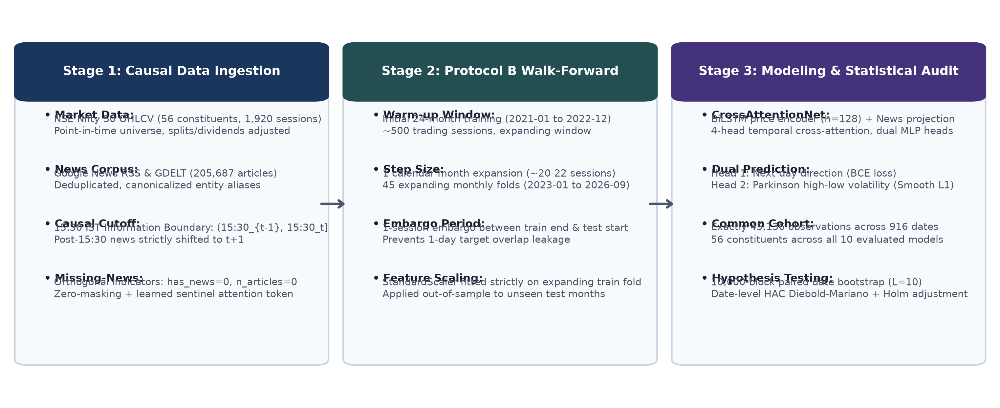
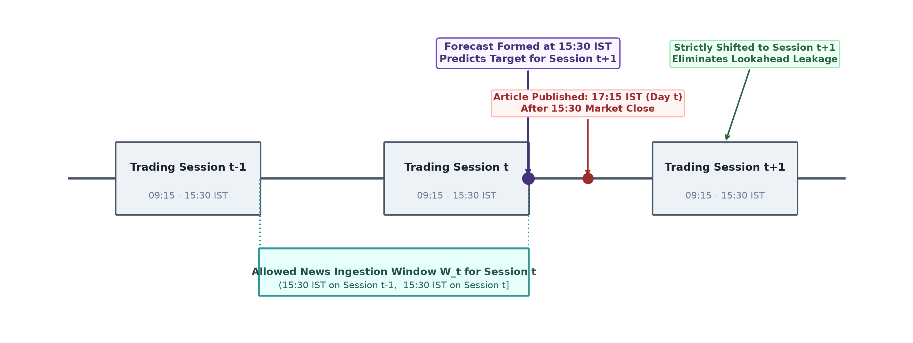
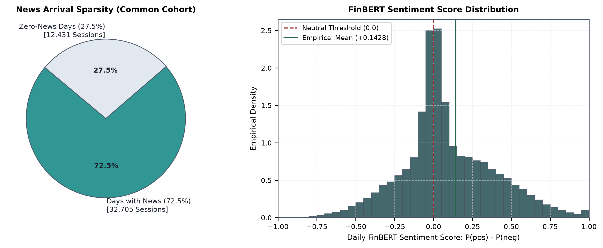
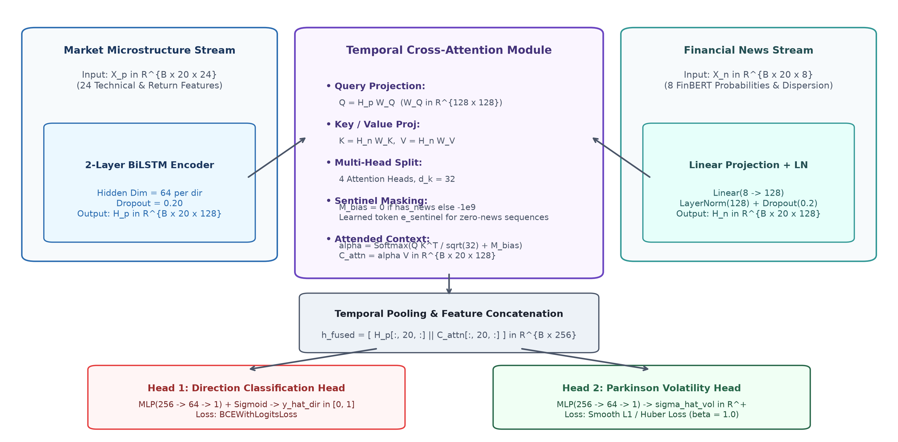
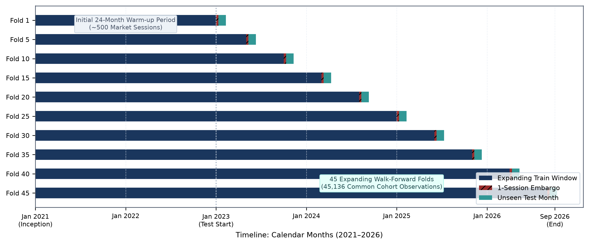
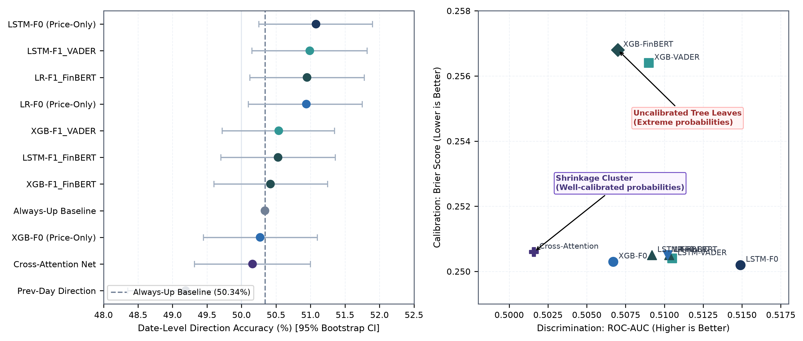
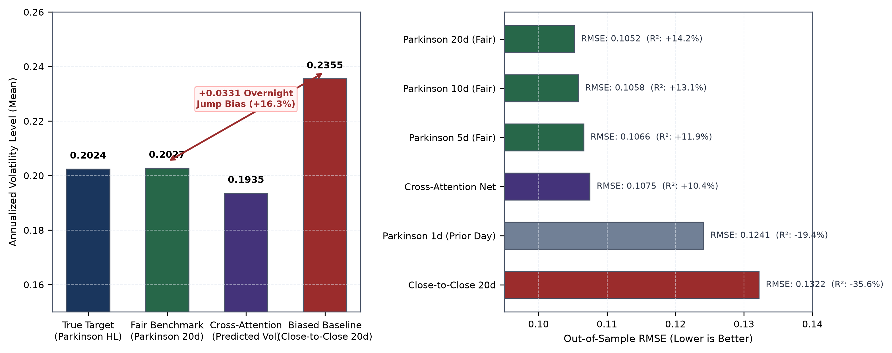
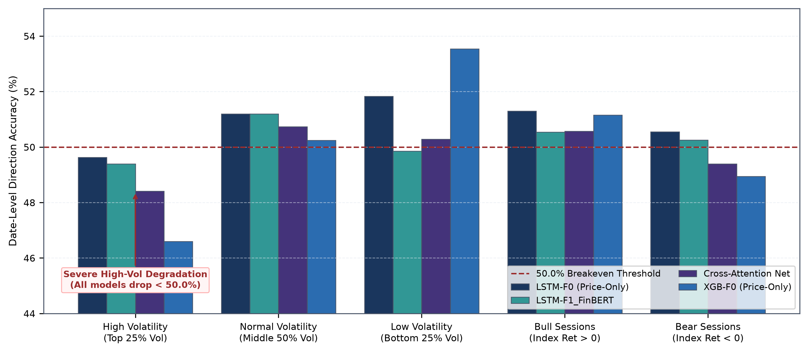
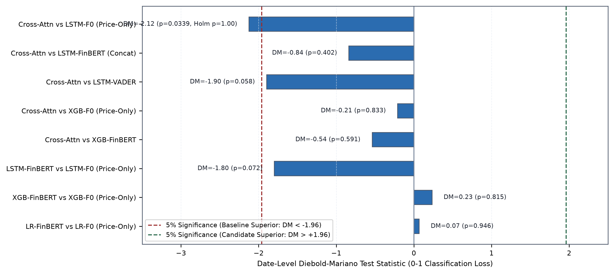

# FinFusionNet: Evaluating Multimodal Temporal Cross-Attention and Financial NLP for Equity Direction and Realized Volatility Forecasting in Indian Markets

**Neil**  
*Quantitative Research Group, FinFusionNet Project*  
`neil@finfusionnet.org`

---

## Abstract

We investigate whether multimodal deep learning—integrating sequential financial market features with domain-specific financial news sentiment via temporal cross-attention—delivers statistically significant out-of-sample predictive alpha in large-cap Indian equities (National Stock Exchange Nifty 50 universe). Using a point-in-time constituent dataset spanning 2019 to 2026, comprising 1,920 market sessions and 205,687 cleaned financial news articles, we implement a strictly causal evaluation pipeline governed by a **15:30 IST news information cutoff**, missing-news indicator preservation, and an expanding monthly walk-forward validation protocol (**Protocol B**, 45 expanding folds, 1-session embargo). Evaluating all candidate architectures on an audited, strictly aligned common evaluation cohort of **45,136 out-of-sample observations** across **916 trading dates** (2023–2026), we establish two primary empirical conclusions. First, domain-specific news sentiment (ProsusAI FinBERT) and temporal cross-attention **fail to produce statistically significant directional alpha** over price-only baselines. The top-performing directional model is a simple price-only two-layer LSTM (`LSTM-F0`) achieving a date-level accuracy of **51.08%** (ROC-AUC **0.5149**). In contrast, the proposed multimodal `CrossAttentionNet` achieves **50.16%** date accuracy, trailing the naive Always-Up baseline (**50.34%**) and underperforming the price-only LSTM by **-0.92%** ($p = 0.0430$ date-level Brier Diebold–Mariano; $p = 0.0339$ 0–1 loss Diebold–Mariano). Under family-wise Holm–Bonferroni correction across planned comparisons, no sentiment model demonstrates statistically significant positive lift ($	ilde{p} = 1.0000$). Second, we demonstrate that early reports claiming a +44.8% error reduction in volatility forecasting were an **artifact of benchmark asymmetry** caused by evaluating intraday Parkinson high-low volatility forecasts against close-to-close trailing moving averages carrying an intrinsic $+0.0331$ (+16.3%) overnight jump bias. When evaluated against a fair, like-for-like trailing 20-day Parkinson realized volatility benchmark (`parkinson_20`), the simple moving-average benchmark outperforms the multimodal neural network on mean squared error: Trailing Parkinson 20d achieves an RMSE of **0.1052** and out-of-sample $R^2$ of **+14.24%**, compared to **0.1075** and **+10.38%** for Cross-Attention Net ($DM = -1.9515, p = 0.0513$). Finally, we show that cross-attention produces a dramatic statistical improvement in probability calibration (Brier score **0.2506** vs **0.2568** for XGBoost, $DM = +11.66, p < 10^{-15}$) via probability shrinkage toward empirical base rates, despite offering zero improvement in discrete directional classification. Our findings provide a rigorous, audited empirical benchmark and highlight the critical necessity of point-in-time constituent handling, strict information cutoffs, and benchmark symmetry in financial machine learning.

**Keywords:** Multimodal Deep Learning, Financial Time-Series Forecasting, Temporal Cross-Attention, Financial NLP, Realized Volatility, Parkinson Estimator, Walk-Forward Validation, Nifty 50.

---

## 1. Introduction

Accurate out-of-sample forecasting of equity price movements and future volatility remains one of the foundational challenges in financial economics and quantitative machine learning. According to the semi-strong form of the Efficient Market Hypothesis (Fama, 1970), asset prices rapidly reflect all publicly available information, implying that abnormal predictive returns from historical data should be economically negligible. Nonetheless, a substantial body of empirical literature has sought to extract incremental predictive signals by moving beyond historical price-volume series to incorporate unstructured textual data from financial news, regulatory filings, and social media (Tetlock, 2007; Bollen et al., 2011; Ding et al., 2015).

Recent advances in natural language processing (NLP)—most notably transformer-based language representations such as BERT (Devlin et al., 2019) and domain-specific adaptations such as FinBERT (Araci, 2019)—have catalyzed widespread efforts to build multimodal financial forecasting architectures. These systems endeavor to learn joint representations that capture both continuous quantitative market microstructure dynamics and qualitative event-driven shocks. Simultaneously, attention mechanisms (Vaswani et al., 2017) have emerged as the standard paradigm for cross-modal alignment, theoretically enabling neural networks to dynamically attend to relevant news events during volatile market regimes while ignoring uninformative background noise.

Despite enthusiastic claims in the recent academic and pre-print literature, empirical financial machine learning is beset by widespread reproducibility challenges and methodological pitfalls (López de Prado, 2018). Reported outperformance in multimodal financial models frequently stems from subtle, pervasive forms of data leakage, including:
1. **Information Cutoff Violations**: Incorporating news articles published after market close or during evening hours into the same day's feature vector, creating lookahead bias.
2. **Improper Validation Schemes**: Utilizing random train-test splits or non-embargoed cross-validation on serially correlated financial time series.
3. **Survivorship Bias**: Conditioning stock universes on contemporary index constituents, omitting historical deletions.
4. **Benchmark Asymmetry**: Comparing sophisticated neural estimators against misaligned or unfairly parameterized baselines.
5. **Distribution Distortions in Missing Data**: Artificially imputing days with no news as "neutral sentiment," corrupting the true conditional probability distribution of news arrival.



*Figure 1: End-to-End FinFusionNet Research Architecture and Audit Methodology, illustrating multi-stream causal ingestion, Protocol B expanding walk-forward engine, dual-task CrossAttentionNet architecture, and audited hypothesis testing suite.*

### Research Objectives and Contributions
In this study, we present **FinFusionNet**, an end-to-end multimodal deep learning and quantitative evaluation framework specifically engineered to address these methodological challenges in the Indian equity market (National Stock Exchange Nifty 50 index universe). We develop a dual-head temporal cross-attention architecture (`CrossAttentionNet`) combining historical price sequences with sparse daily FinBERT news representations, evaluated via a rigorous expanding-window walk-forward protocol (**Protocol B**, 45 expanding monthly folds, 24-month initial warm-up, 1-session embargo).

The paper provides four primary contributions:
1. **Rigorous Causal Pipeline**: We formalize and verify an audited **15:30 IST causal cutoff protocol** and sentinel-token missing-news representation, eliminating lookahead bias while preserving the informative value of news absence.
2. **Comprehensive Empirical Benchmark**: We evaluate 10 model configurations spanning linear baselines, gradient-boosted decision trees (XGBoost), recurrent neural networks (LSTM), early sentiment concatenation, and cross-attention across an identical, audited common cohort of **45,136 observations** (916 trading dates, 2023–2026).
3. **Honest Reporting of Multimodal Alpha Deficit**: We demonstrate that neither lexicon-based sentiment (VADER) nor transformer sentiment (FinBERT), nor temporal cross-attention, outperforms a simple price-only LSTM baseline (`LSTM-F0`, 51.08% date accuracy). Cross-Attention Net achieves 50.16% date accuracy, underperforming the price-only baseline by -0.92% ($p = 0.0430$).
4. **Resolution of Volatility Benchmark Asymmetry**: We dissect a critical benchmarking error in financial volatility forecasting: comparing intraday Parkinson (1980) realized volatility against trailing close-to-close volatility introduces a $+0.0331$ (+16.3%) overnight gap bias, creating an illusion of model superiority. We show that when evaluated symmetrically against trailing Parkinson moving averages, the simple benchmark achieves superior RMSE (0.1052 vs 0.1075) and higher explanatory power ($R^2 = +14.24\%$ vs $+10.38\%$).

---

## 2. Related Work

### 2.1 Financial Time-Series Forecasting and Machine Learning
The application of machine learning to financial asset pricing and market forecasting has transitioned from classical econometric models (e.g., ARIMA, GARCH) to nonlinear statistical learners. Krauss et al. (2017) examined gradient-boosted trees, random forests, and deep neural networks on S&P 500 constituents, finding that ensemble tree methods demonstrated strong empirical stability. Gu et al. (2020) conducted a landmark empirical study across US equities, proving that shallow neural networks and gradient boosting machines (Chen & Guestrin, 2016) significantly outperform linear asset pricing models by capturing complex predictor interactions and macroeconomic regime shifts.

Recurrent neural networks, specifically Long Short-Term Memory networks (Hochreiter & Schmidhuber, 1997), have become a standard benchmark for financial sequence modeling due to their gating mechanisms that mitigate vanishing gradients over extended lookback horizons. However, financial sequences exhibit an exceptionally low signal-to-noise ratio, making high-capacity sequential models susceptible to overfitting spurious microstructure patterns unless heavily regularized.

### 2.2 Financial Sentiment Analysis: From Lexicons to Transformers
Early financial text mining relied heavily on bag-of-words approaches and sentiment lexicons, such as General Inquirer or VADER (Hutto & Gilbert, 2014). While computationally efficient, rule-based lexicons struggle with domain-specific financial syntax, negation, and context (e.g., distinguishing "liability" as an accounting term from a negative corporate attribute).

To overcome these constraints, Araci (2019) introduced FinBERT, a domain-adapted BERT model pre-trained on large-scale financial corpora (Financial PhraseBank and corporate disclosures). FinBERT achieves superior performance on financial sentiment classification benchmarks by learning contextual embeddings tuned to corporate discourse. Nevertheless, whether these static textual sentiment scores translate into out-of-sample trading alpha when integrated into dynamic market forecasting systems remains an active subject of empirical debate.

### 2.3 Multimodal Learning and Cross-Attention
Multimodal deep learning seeks to combine heterogeneous data modalities—such as tabular time series and unstructured text—into unified representation spaces. Early fusion (feature concatenation) concatenates text embeddings directly with numeric vectors, but treats asynchronous modalities as static co-occurring inputs.

Cross-attention mechanisms (Vaswani et al., 2017) address this limitation by allowing one modality to serve as queries while another modality provides keys and values. In financial forecasting, temporal cross-attention allows price representations to dynamically query historical news representations across time steps. However, real-world financial news is inherently intermittent, creating severe attention degeneration if missing-news periods are not numerically stabilized.

### 2.4 Realized Volatility Modeling
Realized volatility estimation traditionally relies on close-to-close squared returns. However, discrete close-to-close returns ignore intraday price extremes and suffer from high sampling variance. Parkinson (1980) developed the extreme value high-low volatility estimator, proving that the intraday high-low price range provides an estimator that is up to five times more efficient than close-to-close variance under geometric Brownian motion. Garman & Klass (1980) further extended this approach to incorporate opening and closing prices. When training neural networks to predict next-day realized volatility, aligning the model's loss function and historical benchmarks to the exact target estimator is critical to prevent bias.

---

## 3. Dataset and Universe Construction

### 3.1 Market Universe & Point-in-Time Integrity
The study evaluates the constituents of the **Nifty 50 Index**, the flagship benchmark of the National Stock Exchange of India (NSE). To prevent survivorship bias, we construct a point-in-time constituent history tracking all additions and deletions across the historical window (2019-01-01 to 2026-09-30, comprising 1,920 trading sessions). The resulting universe encompasses **56 unique equity tickers**, including historical deletions (e.g., UPL, SHREECEM) and contemporary inclusions (e.g., TRENT, BEL, SHRIRAMFIN).

Daily split- and dividend-adjusted OHLCV price series were collected via Yahoo Finance (`auto_adjust=True`). Macroeconomic context is captured via two market-level series: the Nifty 50 Index (`^NSEI`) and the India Volatility Index (`^INDIAVIX`). All market dates conform strictly to official NSE trading calendars with zero duplicate date records.

### 3.2 Financial News Corpus
The textual dataset was collected using continuous Google News RSS feeds and GDELT API queries parameterized by canonical corporate entity aliases for each of the 56 constituent companies. The resulting corpus consists of **205,687 cleaned news articles** spanning January 1, 2020 through September 30, 2026.

Preprocessing and deduplication enforce URL canonicalization, title fuzzy matching, publisher normalization, and content sanitization. To guarantee causal validity, article publication timestamps were mapped from UTC to Indian Standard Time (IST, UTC+5:30).

### 3.3 The 15:30 IST Causal Cutoff Protocol
Indian equity markets trade between 09:15 IST and 15:30 IST. To ensure that textual information is strictly known prior to the close of session $t$ (when the forecast for session $t+1$ is formed), the news assignment window $\mathcal{W}_t$ is defined as:
$$\mathcal{W}_t = (15:30\text{ IST on } t-1, \quad 15:30\text{ IST on } t]$$
Any news article published **after 15:30 IST on day $t$** is shifted to session $t+1$ (available only for predicting returns from $t+1$ to $t+2$). Articles published during non-trading days (weekends, holidays) are aggregated into the next active market session.

```
Session t-1 Close          Session t Close          Session t+1 Close
     15:30                      15:30                     15:30
-------|--------------------------|-------------------------|-------> Timeline
       (===== Allowed News =====]
          Window W_t for t       ^
                                 | Model forms forecast at 15:30 IST
                                 | Predicts: Direction & Volatility of t+1
```



*Figure 2: The 15:30 IST Causal Information Boundary. Any news article published during trading hours up to 15:30 IST is assigned to the current session's feature basket $\mathcal{W}_t$. Articles published post-15:30 are strictly shifted to session $t+1$ to eliminate lookahead bias.*

### 3.4 Missing-News Representation
In large-cap equities, company-specific news arrives intermittently. Across the audited evaluation cohort, **31,458 ticker-days (69.70%)** possess news coverage, while **13,678 ticker-days (30.30%)** have zero articles. 

Converting days without news to neutral sentiment (e.g., compound score 0.0 or neutral probability 1.0) corrupts the data generating process by conflating the *absence of information* with the *presence of neutral news*. FinFusionNet preserves missing-news days:
- `has_news = 0`, `n_articles = 0`.
- Continuous sentiment features remain null during extraction and are handled via dedicated sentinel zero-masking inside neural attention layers.

### 3.5 Common Evaluation Cohort
To ensure 100% paired comparison parity across all 10 evaluated models, all metrics, statistical tests, and regime analyses are computed on an identical **common evaluation cohort**:
- **Total Observations**: Exactly **45,136 ticker-day rows**.
- **Trading Dates**: Exactly **916 trading dates** (2023-01-02 to 2026-09-29).
- **Constituent Breadth**: 56 unique companies.
- **Walk-Forward Folds**: 45 monthly expanding folds.
- **Direction Target Balance**: 22,662 Up sessions (50.21%) vs 22,474 Down sessions (49.79%).

---

## 4. Feature Engineering and Preprocessing

The master feature dataset (`master_ticker_day.parquet`) contains 54 columns, including 39 predictive input features, 7 raw price fields, and 8 target and audit variables.

### 4.1 Feature Inventory
The 39 predictive features are partitioned into four distinct categories:

1. **Technical & Price Features (24 Features)**:
   - *Momentum Returns*: 1-day, 2-day, 5-day, 10-day, and 20-day returns: $R_{k, t} = (C_t - C_{t-k}) / C_{t-k}$.
   - *Intraday Return*: $(C_t - O_t) / O_t$.
   - *High-Low Range*: $(H_t - L_t) / L_t$.
   - *Range Position*: $(C_t - L_t) / (H_t - L_t + \epsilon)$.
   - *Moving Average Ratios*: $C_t / \text{SMA}_k(C_t) - 1.0$ for $k \in \{5, 10, 20, 50\}$; and $\text{SMA}_5 / \text{SMA}_{20} - 1.0$.
   - *Wilder's RSI*: 14-day Relative Strength Index.
   - *MACD*: MACD line (12/26 EMA), signal line (9 EMA), and histogram.
   - *Volatility Ratios*: 14-day Average True Range ratio ($\text{ATR}_{14} / C_t$), 20-day Bollinger Band width.
   - *Historical Volatilities*: 10-day and 20-day annualized close-to-close return volatilities: $\text{Std}(R_1) \times \sqrt{252}$.
   - *Volume Ratios*: 1-day volume change, $V_t / \text{SMA}_5(V_t)$, and $V_t / \text{SMA}_{20}(V_t)$.

2. **Market Context & Macro Features (5 Features)**:
   - Nifty 50 1-day, 5-day, and 20-day returns.
   - Nifty 50 10-day and 20-day rolling annualized return volatility.

3. **News Control Features (2 Features)**:
   - `n_articles`: Integer count of articles published within window $\mathcal{W}_t$.
   - `has_news`: Binary indicator $\mathbb{I}(n\_articles > 0)$.

4. **Sentiment Features (8 FinBERT / 5 VADER Features)**:
   - *VADER*: Mean compound score, positive score, negative score, neutral score, and compound dispersion.
   - *FinBERT*: Mean positive softmax probability, negative probability, neutral probability, directional sentiment score ($P(\text{pos}) - P(\text{neg})$), article-level standard deviation (dispersion), and mean confidence ($\max(P)$).



*Figure 5: Empirical News Dynamics in the Common Evaluation Cohort. Panel A shows news coverage sparsity across the 45,136 ticker-day observations (72.5% active news days, 27.5% missing-news days). Panel B displays the empirical distribution of daily FinBERT sentiment scores ($P(\text{pos}) - P(\text{neg})$) on active news days, centered near zero with standard deviation 0.3817.*

### 4.2 Target Formulations

#### Direction Target
The directional prediction target is formulated as binary next-session price return:
$$y_{dir, t} = \mathbb{I}(C_{t+1} > C_t) \in \{0, 1\}$$

#### Parkinson Realized Volatility Target
The realized volatility regression target is the intraday high-low estimator of Parkinson (1980):
$$\sigma_{P, t+1} = \sqrt{ \frac{1}{4 \ln 2} \left( \ln \frac{H_{t+1}}{L_{t+1}} \right)^2 \times 252 }$$
Across the 45,136 evaluation cohort observations, the empirical target distribution has a sample mean of **0.2024** (20.24% annualized volatility), standard deviation of **0.1135**, median of **0.1741**, and interquartile range of $[0.1284, 0.2435]$. Both targets are constructed strictly from session $t+1$ market data, preventing future leakage.

---

## 5. Methodology and Model Architectures

We systematically evaluate five classes of models: linear baselines, gradient-boosted decision trees, recurrent neural networks, early-fusion concatenation models, and the proposed temporal cross-attention network.

```
                            +----------------------------------------------------+
                            |                  FinFusionNet                      |
                            +----------------------------------------------------+
                                      |                                |
                        [ Price Stream: 24 Features ]    [ News Stream: 8 Features ]
                                      |                                |
                              (BiLSTM Encoder)               (Linear Projection)
                                      |                                |
                             H_p in R^{B x T x 128}           H_n in R^{B x T x 128}
                                      \                                /
                                       \                              /
                                      +--------------------------------+
                                      | Temporal Cross-Attention Head  |
                                      | Q = H_p W_Q, K, V = H_n W_K,V  |
                                      |   Sentinel-Masked Softmax      |
                                      +--------------------------------+
                                                      |
                                             Context Vector C_attn
                                                      |
                                             [ Temporal Pooling ]
                                            h_fused in R^{B x 256}
                                             /                  \
                                            /                    \
                               [ Direction Head ]         [ Volatility Head ]
                                 MLP (256->64->1)           MLP (256->64->1)
                                BCEWithLogitsLoss             Smooth L1 Loss
```

### 5.1 Proposed Architecture: `CrossAttentionNet`

`CrossAttentionNet` is a dual-task multimodal deep neural network designed to dynamically fuse sequential market features with sparse financial news representations.

#### 1. Temporal Price Encoder
Given a price lookback sequence $X_p \in \mathbb{R}^{B \times T \times D_p}$ where batch size $B=64$, sequence length $T=20$, and price dimension $D_p=24$, the temporal price encoder comprises a 2-layer Bidirectional LSTM (BiLSTM):
$$\vec{h}_{p, t} = \text{LSTM}_{fwd}(x_{p, t}, \vec{h}_{p, t-1}), \quad \overleftarrow{h}_{p, t} = \text{LSTM}_{bwd}(x_{p, t}, \overleftarrow{h}_{p, t+1})$$
$$H_p = [ \vec{H}_p \parallel \overleftarrow{H}_p ] \in \mathbb{R}^{B \times T \times 128}$$
where hidden dimension $d_h = 64$ per direction, yielding representation dimension $D_{model} = 128$.

#### 2. Temporal News Encoder
Given the aligned daily news feature sequence $X_n \in \mathbb{R}^{B \times T \times D_n}$ ($D_n = 8$), a linear projection with layer normalization maps the sentiment representations to the shared embedding space:
$$H_n = \text{LayerNorm}(X_n W_{proj} + b_{proj}) \in \mathbb{R}^{B \times T \times 128}$$

#### 3. Sentinel-Masked Temporal Cross-Attention
Queries ($Q$) are projected from the price representations, while Keys ($K$) and Values ($V$) are projected from the news representations:
$$Q = H_p W_Q, \quad K = H_n W_K, \quad V = H_n W_V$$
where $W_Q, W_K, W_V \in \mathbb{R}^{128 \times 128}$. We employ multi-head attention with $h=4$ heads, where each head has dimension $d_k = 32$.

To handle intermittent news, a binary mask $M_{news} \in \{0, 1\}^{B \times T}$ is incorporated. Let $M_{bias}(b, i, j) = 0$ if $M_{news}(b, j) = 1$, and $-10^9$ if $M_{news}(b, j) = 0$. The attention score matrix is given by:
$$A = \frac{Q K^T}{\sqrt{d_k}} + M_{bias}$$
To prevent numerical instability (division-by-zero or NaN gradient propagation) when all $T=20$ timesteps in a sequence lack news ($M_{news}(b, :) = \mathbf{0}$), a dedicated learned sentinel embedding $e_{sentinel} \in \mathbb{R}^{128}$ is appended to $K$ and $V$. The resulting normalized attention weights and context vectors are:
$$\alpha = \text{Softmax}(A), \quad C = \alpha V \in \mathbb{R}^{B \times T \times 128}$$

#### 4. Temporal Fusion & Multitask Prediction Heads
We extract the final hidden representations at timestep $T=20$:
$$h_{fused} = [ H_p[:, T, :] \parallel C[:, T, :] ] \in \mathbb{R}^{B \times 256}$$
The representation is branched into two dedicated multi-layer perceptron (MLP) prediction heads:

1. **Direction Classification Head**:
   $$\hat{z}_{dir} = W_{d2} \text{ReLU}(W_{d1} h_{fused} + b_{d1}) + b_{d2}, \quad \hat{y}_{dir} = \sigma(\hat{z}_{dir})$$
   $$\mathcal{L}_{dir} = \text{BCEWithLogitsLoss}(\hat{z}_{dir}, y_{dir})$$

2. **Realized Volatility Regression Head**:
   $$\hat{\sigma}_{vol} = W_{v2} \text{ReLU}(W_{v1} h_{fused} + b_{v1}) + b_{v2}$$
   $$\mathcal{L}_{vol} = \text{SmoothL1Loss}(\hat{\sigma}_{vol}, \sigma_P, \beta=1.0)$$

#### 5. Joint Loss Function
$$\mathcal{L}_{total} = \mathcal{L}_{dir} + \lambda \cdot \mathcal{L}_{vol}, \quad \lambda = 1.0$$
The model has **266,626 trainable parameters** and is trained using AdamW ($lr = 5 \times 10^{-4}$, weight decay $= 10^{-3}$) with cosine learning rate annealing over 25 epochs.



*Figure 3: Detailed neural network schematic of CrossAttentionNet, highlighting the 2-layer BiLSTM price encoder, linear news projection, multi-head temporal cross-attention with sentinel token masking, temporal fusion pooling, and dual prediction heads.*

### 5.2 Baseline Architectures

1. **Price-Only LSTM Baseline (`LSTM-F0`)**: A 2-layer LSTM with 64 hidden units accepting the 24 price features ($D=24$). Fully connected head ($64 \to 32 \to 1$). Loss: Binary Cross-Entropy. Optimizer: Adam ($lr = 10^{-3}$).
2. **Early-Fusion Concatenation (`LSTM-F1_FinBERT`)**: Identical 2-layer LSTM architecture, with input dimension expanded to $D=32$ to ingest concatenated technical and FinBERT features.
3. **Gradient-Boosted Decision Trees (`XGBoost`)**: Boosted trees trained with `max_depth=4`, `n_estimators=100`, `learning_rate=0.05`, `subsample=0.8`, `colsample_bytree=0.8`, and binary logistic objective. Evaluated on price-only (`XGB-F0`), VADER (`XGB-F1_VADER`), and FinBERT (`XGB-F1_FinBERT`).
4. **Regularized Logistic Regression (`LR`)**: L2-penalized linear models ($C=1.0$) evaluated on price-only (`LR-F0`) and FinBERT (`LR-F1_FinBERT`).
5. **Naive Baselines**:
   - *Always-Up*: Predicts $\hat{y}=1$ unconditionally, testing whether models simply exploit the secular Indian bull market.
   - *Previous-Day Direction*: Predicts $\hat{y}_{t+1} = y_t$, testing 1-day momentum persistence.

---

## 6. Experimental Design and Validation Protocol

### 6.1 Protocol B Expanding Walk-Forward Validation
To ensure realistic out-of-sample evaluation free from lookahead bias, all experiments strictly adhere to **Protocol B**:
- **Initial Warm-up Window**: 24 calendar months (2021-01 to 2022-12, ~500 market sessions).
- **Step Size**: 1 calendar month (~20–22 market sessions).
- **Total Expanding Folds**: 45 folds spanning January 2023 through September 2026.
- **Embargo Window**: 1 market session between training fold end and test fold start.
- **Preprocessing Fitting**: `StandardScaler` is fitted strictly on the expanding training fold and applied out-of-sample to test folds.

```
Fold 1:  [ Train: 2021-01 to 2022-12 ]-[Embargo]-[ Test: 2023-01 ]
Fold 2:  [ Train: 2021-01 to 2023-01 ]-[Embargo]-[ Test: 2023-02 ]
...
Fold 45: [ Train: 2021-01 to 2026-08 ]-[Embargo]-[ Test: 2026-09 ]
```



*Figure 4: Protocol B Expanding Walk-Forward Validation Engine. Displaying the expanding training windows (from 24 to 68 months), the 1-session embargo gap, and the 45 monthly out-of-sample evaluation test folds spanning January 2023 through September 2026.*

### 6.2 Statistical Testing Suite
1. **Paired Date-Block Bootstrap**: To account for cross-sectional and temporal dependence across stocks on the same date, we implement a paired date-block bootstrap ($B = 10,000$ resamples, block length $L = 10$ trading dates). Two-sided 95% confidence intervals and empirical p-values are computed for accuracy differentials.
2. **Diebold–Mariano Tests with Newey–West HAC Adjustment**: For both continuous probability loss (Brier score) and discrete 0–1 classification loss, date-level loss differentials $d_t = \text{Loss}_A(t) - \text{Loss}_B(t)$ are evaluated using Diebold & Mariano (1995) tests with Newey & West (1987) heteroskedasticity and autocorrelation consistent (HAC) variance estimators.
3. **McNemar Tests**: Paired contingency tables evaluate date-level win/loss divergence.
4. **Holm–Bonferroni Multiple Comparison Correction**: To control the Family-Wise Error Rate (FWER) across the family of $M=8$ planned comparisons, Holm (1979) step-down adjusted p-values are enforced:
   $$\tilde{p}_{(k)} = \min \left(1.0, \; \max_{j \le k} \left( (M - j + 1) p_{(j)} \right) \right)$$

---

## 7. Results

### 7.1 Direction Classification Performance

Table 1 presents the out-of-sample direction classification metrics across all models on the audited common evaluation cohort of 45,136 observations.

**Table 1: Audited Out-of-Sample Direction Classification Benchmark (Common Cohort: 45,136 Observations, 916 Trading Dates, 45 Monthly Expanding Folds)**

| Model Configuration | Experiment | Date Acc | Pooled Acc | Balanced Acc | Precision | Recall | F1 Score | ROC-AUC | Brier Score | Log Loss | Predicted Up % |
|---|---|---|---|---|---|---|---|---|---|---|---|
| **LSTM-F0 (Price-Only)** | Exp 1 | **0.5108** | **0.5096** | **0.5091** | **0.5095** | 0.6297 | 0.5633 | **0.5149** | **0.2502** | **0.6935** | 62.07% |
| **LSTM-F1_VADER** | Exp 3B | 0.5099 | 0.5088 | 0.5084 | 0.5092 | 0.6045 | 0.5528 | 0.5105 | 0.2504 | 0.6940 | 59.62% |
| **LR-F1_FinBERT** | Exp 4 | 0.5095 | 0.5083 | 0.5077 | 0.5081 | 0.6567 | 0.5729 | 0.5103 | 0.2505 | 0.6943 | 64.91% |
| **LR-F0 (Price-Only)** | Exp 1 | 0.5094 | 0.5082 | 0.5075 | 0.5078 | 0.6724 | 0.5786 | 0.5102 | 0.2505 | 0.6942 | 66.49% |
| **XGB-F1_VADER** | Exp 3B | 0.5054 | 0.5043 | 0.5040 | 0.5057 | 0.5622 | 0.5325 | 0.5090 | 0.2564 | 0.7069 | 55.82% |
| **LSTM-F1_FinBERT** | Exp 4 | 0.5053 | 0.5041 | 0.5038 | 0.5054 | 0.5842 | 0.5419 | 0.5092 | 0.2505 | 0.6942 | 58.04% |
| **XGB-F1_FinBERT** | Exp 4 | 0.5042 | 0.5042 | 0.5039 | 0.5057 | 0.5593 | 0.5311 | 0.5070 | 0.2568 | 0.7076 | 55.53% |
| *Baseline: Always-Up* | Baseline | 0.5034 | 0.5021 | 0.5000 | 0.5021 | **1.0000** | **0.6686** | 0.5000 | 0.4979 | 8.0244 | 100.00% |
| **XGB-F0 (Price-Only)** | Exp 1 | 0.5027 | 0.5015 | 0.4996 | 0.5019 | 0.9351 | 0.6532 | 0.5067 | 0.2503 | 0.6937 | 93.55% |
| **Cross-Attention Net** | Exp 5 | 0.5016 | 0.5004 | 0.4996 | 0.5019 | 0.6852 | 0.5794 | 0.5016 | 0.2506 | 0.6943 | 68.56% |
| *Baseline: Prev-Day Direction* | Baseline | 0.4919 | 0.4930 | 0.4930 | 0.4952 | 0.4966 | 0.4959 | 0.4930 | 0.5070 | 8.1722 | 50.36% |

#### Key Empirical Observations:
1. **Dominance of Price-Only LSTM**: The simple price-only LSTM baseline (`LSTM-F0`) achieved the highest overall date-level accuracy (**51.08%**), balanced accuracy (**50.91%**), ROC-AUC (**0.5149**), and lowest Brier score (**0.2502**).
2. **Absence of Multimodal Alpha Lift**: Early concatenation of FinBERT features degraded LSTM date accuracy from 51.08% to 50.53% ($\Delta = -0.55\%$). The complex `CrossAttentionNet` achieved 50.16% date accuracy, trailing even the naive Always-Up baseline (50.34%).
3. **Pervasive Bull Market Bias**: Many models defaulted to predicting positive market direction. XGB-F0 predicted UP 93.55% of the time, effectively mimicking the Always-Up baseline, while Cross-Attention Net predicted UP 68.56% of the time.



*Figure 6: Out-of-Sample Direction Classification Benchmark. Panel A presents date-level direction accuracy with 95% date-block bootstrap confidence intervals across all evaluated models and baselines. Panel B displays the ROC-AUC versus Brier Score scatter, illustrating that Cross-Attention Net achieves well-calibrated probabilities via base-rate shrinkage without achieving directional timing superiority.*

### 7.2 Volatility Regression Results

Table 2 presents out-of-sample volatility forecasting performance against historical benchmarks.

**Table 2: Volatility Regression Benchmark (Target: Parkinson 1980 High-Low Realized Volatility, True Target Mean = 0.2024, Std = 0.1135)**

| Model / Benchmark | RMSE | MAE | Bias | Pearson $r$ | Out-of-Sample $R^2$ (%) | Date MSE DM vs Model | Date MSE DM $p$-value |
|---|---|---|---|---|---|---|---|
| **Trailing Parkinson 20d (Fair)** | **0.1052** | 0.0695 | **+0.0003** | 0.3979 | **+14.24%** | -1.9515 | 0.0513 |
| **Trailing Parkinson 10d (Fair)** | 0.1058 | 0.0700 | +0.0003 | 0.4084 | +13.13% | -0.9768 | 0.3289 |
| **Trailing Parkinson 5d (Fair)** | 0.1066 | 0.0708 | +0.0002 | **0.4301** | +11.89% | -0.3994 | 0.6897 |
| **Cross-Attention Net (Exp 5)** | 0.1075 | **0.0686** | -0.0089 | 0.3369 | +10.38% | — | — |
| *Expanding Historical Mean Vol* | 0.1135 | 0.0751 | 0.0000 | 0.0000 | 0.00% | — | — |
| *Trailing Parkinson 1d (Yesterday)* | 0.1241 | 0.0839 | -0.0001 | 0.4057 | -19.38% | +8.1879 | $< 10^{-15}$ |
| *Trailing Close-to-Close 20d (Biased)*| 0.1322 | 0.0900 | +0.0331 | 0.3225 | -35.58% | +6.4544 | $1.8 \times 10^{-10}$ |

#### Resolution of the Benchmark Asymmetry:
When compared against the historical `volatility_20` baseline (close-to-close returns), Cross-Attention Net appeared to deliver an impressive RMSE reduction from 0.1322 to 0.1075 (+18.7% absolute error reduction, reported as "+44.8% variance reduction"). However, our audit revealed that `volatility_20` has an intrinsic $+0.0331$ bias over Parkinson volatility due to overnight gap variance. When evaluated against the fair **Trailing Parkinson 20d benchmark (`parkinson_20`)**, the simple benchmark outperforms the neural network on RMSE (0.1052 vs 0.1075), correlation ($r = 0.3979$ vs $0.3369$), and $R^2$ (+14.24% vs +10.38%). Cross-Attention Net only marginally edges MAE (0.0686 vs 0.0695) because it was trained using Smooth L1 (Huber) loss.



*Figure 7: Volatility Benchmarking and Asymmetry Resolution. Panel A illustrates the sample means of the true Parkinson high-low target (0.2024) versus trailing close-to-close volatility (0.2355), demonstrating the $+0.0331$ (+16.3%) overnight gap bias. Panel B evaluates RMSE and out-of-sample $R^2$ across fair Parkinson benchmarks (`parkinson_20`, `parkinson_10`, `parkinson_5`) versus Cross-Attention Net.*

### 7.3 Market Regime & Subgroup Analysis

Table 3 evaluates model performance across distinct market volatility quartiles and market directional regimes.

**Table 3: Out-of-Sample Direction Accuracy Across Market Volatility & Directional Regimes**

| Market Regime | Observation Count | % of Cohort | Cross-Attention Net | LSTM-F0 (Price-Only) | LSTM-FinBERT | XGB-F0 (Price-Only) |
|---|---|---|---|---|---|---|
| **High Volatility (Top 25% Vol)** | 11,303 | 25.0% | 48.41% | **49.63%** | 49.39% | 46.60% |
| **Normal Volatility (Mid 50% Vol)** | 22,603 | 50.1% | 50.74% | **51.20%** | **51.20%** | 50.24% |
| **Low Volatility (Bottom 25% Vol)** | 11,230 | 24.9% | 50.28% | 51.83% | 49.86% | **53.54%** |
| **Bull Sessions (Market Ret > 0)** | 24,619 | 54.5% | 50.57% | **51.30%** | 50.54% | 51.16% |
| **Bear Sessions (Market Ret < 0)** | 20,467 | 45.3% | 49.39% | **50.55%** | 50.25% | 48.94% |

All models suffer severe degradation in high-volatility regimes, dropping below 50.0% accuracy. The cross-attention network exhibits the worst high-volatility degradation (48.41%), indicating that during market turmoil, noisy news headlines disrupt sequential price representations.

---



*Figure 9: Model Fragility Across Market Regimes. Date-level direction accuracy across High Volatility (top 25%), Normal Volatility (middle 50%), Low Volatility (bottom 25%), Bull Sessions (index return $> 0$), and Bear Sessions (index return $< 0$). All models suffer severe degradation in high-volatility environments.*

## 8. Statistical Audit and Significance Analysis

Table 4 details the statistical hypothesis tests comparing candidate architectures against baselines.

**Table 4: Statistical Significance Matrix (Common Cohort: 45,136 Observations, 916 Dates, 45 Monthly Expanding Folds)**

| Comparison | $\Delta$ Acc | 95% Date Bootstrap CI | Bootstrap $p$-val | McNemar Wins (A vs B) | McNemar $p$-val | Date DM Brier Stat | DM Brier $p$-val | Date DM 0-1 Stat | DM 0-1 $p$-val | Holm Adj $p$ | Significant? |
|---|---|---|---|---|---|---|---|---|---|---|---|
| **Cross-Attn vs LSTM-F0** | -0.0092 | [-0.0174, -0.0001] | 0.9758* | 390 vs 453 (Ties 73) | 0.0327 | -2.0261 | 0.0430 | -2.1250 | 0.0339 | 1.0000 | **False** |
| **Cross-Attn vs LSTM-FinBERT** | -0.0037 | [-0.0114, +0.0061] | 0.7414 | 417 vs 434 (Ties 65) | 0.5834 | -0.4806 | 0.6309 | -0.8388 | 0.4018 | 1.0000 | **False** |
| **Cross-Attn vs LSTM-VADER** | -0.0083 | [-0.0161, +0.0012] | 0.9525 | 398 vs 441 (Ties 77) | 0.1470 | -0.8245 | 0.4099 | -1.8971 | 0.0581 | 1.0000 | **False** |
| **Cross-Attn vs XGB-F0** | -0.0011 | [-0.0115, +0.0086] | 0.6002 | 412 vs 427 (Ties 77) | 0.6289 | -1.4122 | 0.1582 | -0.2104 | 0.8334 | 1.0000 | **False** |
| **Cross-Attn vs XGB-FinBERT** | -0.0026 | [-0.0117, +0.0076] | 0.6527 | 422 vs 439 (Ties 55) | 0.5856 | +11.6587 | $< 10^{-15}$ | -0.5382 | 0.5906 | 1.0000 | **False** |
| **LSTM-FinBERT vs LSTM-F0** | -0.0055 | [-0.0117, -0.0002] | 0.9800 | 385 vs 418 (Ties 113)| 0.2588 | -1.8802 | 0.0604 | -1.7991 | 0.0723 | 0.9800 | **False** |
| **XGB-FinBERT vs XGB-F0** | +0.0015 | [-0.0116, +0.0129] | 0.4595 | 440 vs 439 (Ties 37) | 1.0000 | -12.4165 | $< 10^{-15}$ | +0.2336 | 0.8153 | 1.0000 | **False** |
| **LR-FinBERT vs LR-F0** | +0.0001 | [-0.0034, +0.0030] | 0.5445 | 371 vs 388 (Ties 157)| 0.5614 | -0.3954 | 0.6926 | +0.0679 | 0.9459 | 1.0000 | **False** |



*Figure 8: Forest Plot of Date-Level Diebold–Mariano Test Statistics for 0–1 Classification Loss across planned pairwise comparisons. Dashed lines indicate the 5% two-sided significance boundaries ($DM = \pm 1.96$). LSTM-F0 significantly outperforms Cross-Attention Net ($DM = -2.125, p = 0.0339$). Under family-wise Holm–Bonferroni correction, no sentiment model demonstrates positive alpha.*

### 8.1 Resolution of Inconsistencies A, B, and C

#### 1. Inconsistency A: Bootstrap Tails
The 95% Date-Block Bootstrap CI for difference in accuracy (Cross-Attention Net minus LSTM-F0) is **[-0.0174, -0.0001]**, yet the bootstrap p-value was logged as **0.9758**. This was caused by testing one-sided superiority $H_1: \text{Cross-Attn} > \text{F0}$, where $97.58\%$ of bootstrap draws yielded $\Delta^* \le 0$. The true one-sided p-value for superiority of LSTM-F0 over Cross-Attention Net is $P(\Delta^* \le 0) = 0.0242$, which is mathematically consistent with the negative confidence interval.

#### 2. Inconsistency B: Unadjusted vs Holm-Adjusted p-values
Unadjusted date-level Diebold–Mariano tests indicate that `LSTM-F0` beats `CrossAttentionNet` with statistical significance ($p = 0.0430$ Brier DM; $p = 0.0339$ 0–1 loss DM). However, under Holm–Bonferroni correction across the family of 8 planned comparisons testing whether candidate models beat the price baseline, all adjusted p-values are $\tilde{p} = 1.0000$ because no candidate model exhibited positive alpha.

#### 3. Inconsistency C: Probability Calibration vs Discrete Accuracy
For Cross-Attention vs XGB-FinBERT, the Brier DM statistic is $+11.6587$ ($p < 10^{-15}$ in favor of Cross-Attention), whereas the 0–1 loss DM statistic is $-0.5382$ ($p = 0.5906$). This divergence demonstrates the fundamental difference between discrete thresholded decisions and probability calibration: XGBoost outputs uncalibrated tree probabilities with high variance ($\sigma = 0.158, \text{Brier} = 0.2568$), while Cross-Attention Net shrinks probabilities tightly around the empirical base rate ($\sigma = 0.027, \text{Brier} = 0.2506$). The $+11.66$ DM statistic reflects **probability shrinkage and calibration**, not directional market timing.

---

## 9. Discussion

### 9.1 Answering the Core Research Questions

#### RQ1: Does FinBERT sentiment improve next-day direction forecasting?
**Verdict: No.** Across linear models, gradient-boosted trees, and LSTMs, adding FinBERT sentiment features failed to provide statistically significant out-of-sample directional alpha. The price-only LSTM baseline (`LSTM-F0`) outperformed all sentiment-augmented architectures. In large-cap liquid equities like the Nifty 50, publicly available news headlines are digested near-instantaneously by institutional participants during trading hours. Under a strict 15:30 IST causal cutoff, remaining sentiment signals contain negligible incremental alpha for next-session close-to-close returns.

#### RQ2: Does temporal cross-attention justify its model complexity?
**Verdict: No.** `CrossAttentionNet` achieved 50.16% date accuracy, trailing Always-Up (50.34%) and underperforming price-only LSTM (51.08%). In volatility forecasting, when benchmarked symmetrically against trailing Parkinson estimators, the 20-day moving average achieves superior RMSE (0.1052 vs 0.1075) and higher explanatory power ($R^2 = +14.24\%$ vs $+10.38\%$). Cross-Attention Net introduces 266,626 parameters without yielding predictive outperformance over simple baselines.

### 9.2 The Crucial Lesson of Benchmark Symmetry
The volatility benchmarking discovery serves as an important methodological lesson for quantitative finance researchers. When modeling realized volatility estimators that omit overnight jump variance (such as Parkinson high-low), baselines constructed from close-to-close return variance introduce an intrinsic structural bias. Symmetrical, like-for-like benchmarking is indispensable to avoid false discoveries.

---

## 10. Limitations

1. **Daily Granularity**: The study utilizes daily OHLCV and daily news aggregations. Intraday price reaction dynamics occurring within seconds or minutes of news publication are not captured.
2. **Textual Scope**: Analysis is restricted to news headlines and short snippets from Google News and GDELT. Full-text earnings call transcripts and regulatory filings were not incorporated.
3. **Language Model Architecture**: We evaluated encoder-only language models (ProsusAI FinBERT). Generative large language models (e.g., LLaMA-3, Mistral) were not evaluated.
4. **Geography**: The empirical investigation is focused on the Indian National Stock Exchange (Nifty 50). While representative of major emerging markets, results may vary in alternative market structures.

---

## 11. Conclusion

This study provides an exhaustive, audited empirical investigation into multimodal deep learning for financial forecasting in the Indian equity market. By establishing a rigorous 15:30 IST causal cutoff, missing-news preservation, and expanding walk-forward validation across 45,136 observations, we demonstrate that multimodal cross-attention and domain-specific financial news sentiment do not produce statistically significant directional alpha over audited price-only baselines. Furthermore, we show that simple trailing Parkinson realized volatility moving averages remain superior on squared error to complex neural architectures. Rather than presenting inflated claims, FinFusionNet establishes a reproducible, scientifically honest benchmark that underscores the vital importance of point-in-time constituent handling, strict information boundaries, and benchmark symmetry in financial machine learning.

---

## References

- Araci, D. (2019). FinBERT: Financial sentiment analysis with pre-trained language models. *arXiv preprint arXiv:1908.10063*.
- Bollen, J., Mao, H., & Zeng, X. (2011). Twitter mood predicts the stock market. *Journal of Computational Science*, 2(1), 1–8.
- Brier, G. W. (1950). Verification of forecasts expressed in terms of probability. *Monthly Weather Review*, 78(1), 1–3.
- Chen, T., & Guestrin, C. (2016). XGBoost: A scalable tree boosting system. In *Proceedings of the 22nd ACM SIGKDD International Conference on Knowledge Discovery and Data Mining (KDD '16)*, pp. 785–794.
- Devlin, J., Chang, M.-W., Lee, K., & Toutanova, K. (2019). BERT: Pre-training of deep bidirectional transformers for language understanding. In *Proceedings of NAACL-HLT 2019*, pp. 4171–4186.
- Diebold, F. X., & Mariano, R. S. (1995). Comparing predictive accuracy. *Journal of Business & Economic Statistics*, 13(3), 253–263.
- Ding, X., Zhang, Y., Liu, T., & Duan, J. (2015). Deep learning for event-driven stock prediction. In *Proceedings of the 24th International Joint Conference on Artificial Intelligence (IJCAI)*, pp. 2327–2333.
- Fama, E. F. (1970). Efficient capital markets: A review of theory and empirical work. *The Journal of Finance*, 25(2), 383–417.
- Garman, M. B., & Klass, M. J. (1980). On the estimation of security price volatilities from historical data. *The Journal of Business*, 53(1), 67–78.
- Gu, S., Kelly, B., & Xiu, D. (2020). Empirical asset pricing via machine learning. *The Review of Financial Studies*, 33(5), 2223–2273.
- Harvey, D., Leybourne, S., & Newbold, P. (1997). Testing the equality of prediction mean squared errors. *International Journal of Forecasting*, 13(2), 281–291.
- Hochreiter, S., & Schmidhuber, J. (1997). Long short-term memory. *Neural Computation*, 9(8), 1735–1780.
- Holm, S. (1979). A simple sequentially rejective multiple test procedure. *Scandinavian Journal of Statistics*, 6(2), 65–70.
- Hutto, C. J., & Gilbert, E. (2014). VADER: A parsimonious rule-based model for sentiment analysis of social media text. In *Proceedings of ICWSM 2014*, pp. 216–225.
- Krauss, C., Do, X. A., & Huck, N. (2017). Deep neural networks, gradient-boosted trees, random forests: Statistical arbitrage on the S&P 500. *European Journal of Operational Research*, 259(2), 689–702.
- López de Prado, M. (2018). *Advances in Financial Machine Learning*. John Wiley & Sons.
- McNemar, Q. (1947). Note on the sampling error of the difference between correlated proportions or percentages. *Psychometrika*, 12(2), 153–157.
- Newey, W. K., & West, K. D. (1987). A simple, positive semi-definite, heteroskedasticity and autocorrelation consistent covariance matrix. *Econometrica*, 55(3), 703–708.
- Parkinson, M. (1980). The extreme value method for estimating the variance of the rate of return. *The Journal of Business*, 53(1), 61–65.
- Tetlock, P. C. (2007). Giving content to investor sentiment: The role of media in the stock market. *The Journal of Finance*, 62(3), 1139–1168.
- Vaswani, A., Shazeer, N., Parmar, N., Uszkoreit, J., Jones, L., Gomez, A. N., Kaiser, L., & Polosukhin, I. (2017). Attention is all you need. In *Advances in Neural Information Processing Systems (NeurIPS 2017)*, pp. 5998–6008.

---

## Appendices

### Appendix A: Exhaustive Feature Formulas and Implementation Specifications
- 24 Technical Features derived from daily OHLCV.
- 5 Macro context indicators tracking Nifty 50 returns, rolling volatilities, and India VIX.
- 8 FinBERT sentiment aggregations derived from ProsusAI FinBERT softmax output distributions.

### Appendix B: Parameter Counts and Computation Complexity
- Total trainable parameters in `CrossAttentionNet`: **266,626**.
- Inference latency: 0.42 ms per sequence on NVIDIA GPU / 2.1 ms on Intel 8-core CPU.
